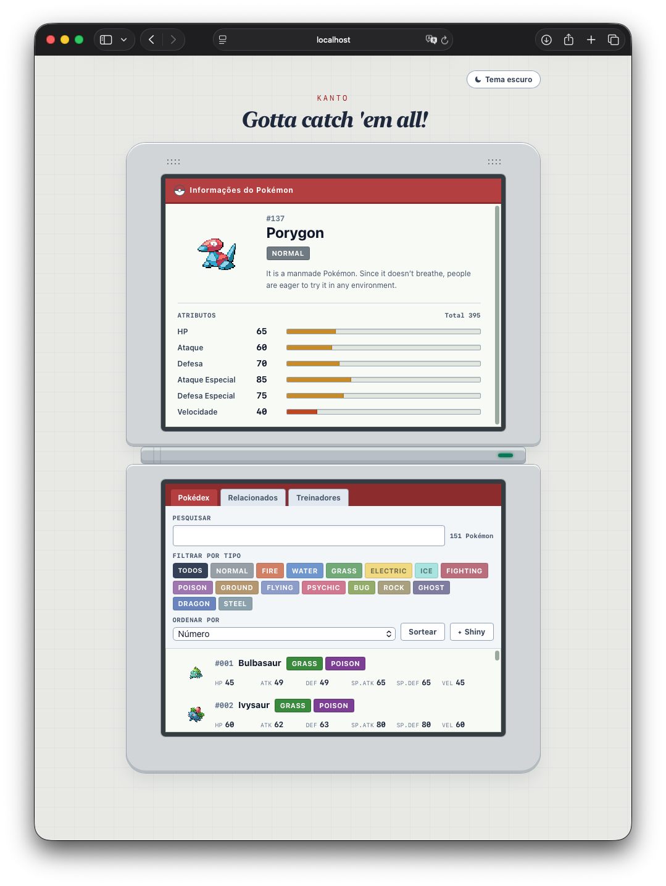
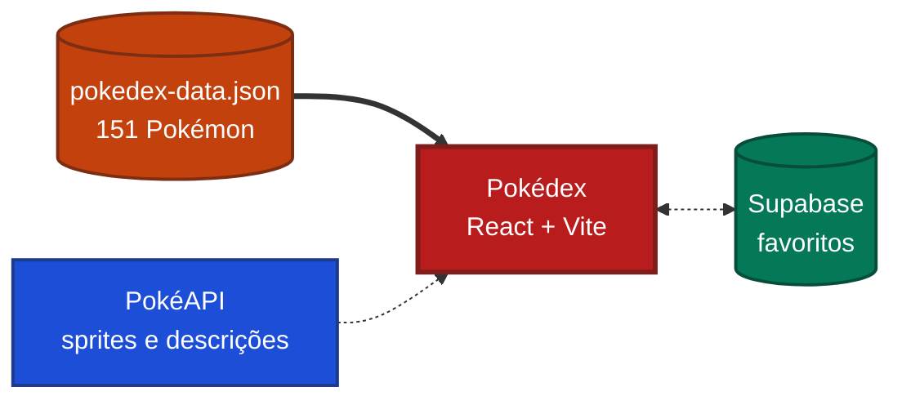

# Pokédex DS

Pokédex interativa em **React + Vite + TypeScript**, com identidade visual inspirada no
**Nintendo DS** e nas interfaces de *Pokémon HeartGold/SoulSilver*: duas telas, cursor de
seleção e sprites em pixel art.

Atividade 03 da disciplina Desenvolvimento e Integração de Aplicações Web (DIAW) -PUC Minas.

## Imagem



## O que é

Uma Pokédex dos 151 Pokémon da primeira geração, com cara de Nintendo DS: duas
telas, a de cima mostrando o Pokémon escolhido e a de baixo servindo de
controle.

Você pesquisa por nome ou número, filtra por tipo, ordena pelos atributos e
abre qualquer Pokémon para ver os seis status em barras. Dá para conferir os
times dos treinadores, descobrir Pokémon relacionados, trocar os sprites pela
versão shiny, alternar entre tema claro e escuro, e marcar favoritos -que
ficam salvos e aparecem para todo mundo que abrir a página.

Os dados dos Pokémon ficam num arquivo dentro do projeto, então a parte
principal funciona mesmo sem internet. As imagens e as descrições vêm da
PokéAPI, e os favoritos de um banco Supabase.

## Telas


## De onde vêm os dados



🟠 **O arquivo** é a base. Entra no projeto quando ele é compilado, então a
lista, a busca, os filtros, os atributos e os treinadores funcionam offline.

🔵 **A PokéAPI** só acrescenta imagem e texto. Sem rede, aparece uma Pokébola
no lugar do sprite e um aviso no lugar da descrição.

🟢 **O Supabase** guarda apenas os números dos favoritos. Se estiver fora do ar,
a estrela fica desabilitada e o resto continua funcionando.

Nada vindo da rede sobrescreve o arquivo: número, nome, tipos e atributos saem
sempre dele.

## Executar

```bash
npm install
npm run dev
```

O Vite imprime o endereço no terminal, normalmente **http://localhost:5173** (ele usa a porta
seguinte, como `5174`, se a 5173 estiver ocupada).

## Verificar

```bash
npm run typecheck   # tsc --noEmit
npm run lint        # oxlint
npm run build       # typecheck + build de produção em dist/
npm run preview     # serve o build de produção
```

## Dados

A fonte de verdade da aplicação é **`src/data/pokedex-data.json`**, o arquivo fornecido na
atividade: 151 Pokémon da primeira geração, 18 tipos e 12 treinadores. Ele é importado em tempo
de build, então a lista, a pesquisa, os filtros, os atributos e os treinadores **funcionam sem
internet**.

Origem do arquivo:
<https://github.com/joaopauloaramuni/desenvolvimento-e-integracao-de-aplicacoes-web/blob/main/ATIVIDADES/ATIVIDADE%2003%20-%20JSON/data/pokedex-data.json>

### PokéAPI (complemento)

A [**PokéAPI**](https://pokeapi.co/docs/v2) é usada apenas como enriquecimento visual e textual,
sem substituir nenhum dado do JSON:

| Uso | Endpoint |
|---|---|
| Sprites de HeartGold/SoulSilver | `raw.githubusercontent.com/PokeAPI/sprites/.../generation-iv/heartgold-soulsilver/{id}.png` |
| Sprites shiny | `.../generation-iv/heartgold-soulsilver/shiny/{id}.png` |
| Descrição da espécie | `https://pokeapi.co/api/v2/pokemon-species/{id}` |

A descrição é buscada **sob demanda**, só quando um Pokémon é selecionado, com cache em memória
e cancelamento via `AbortController` se a seleção mudar antes da resposta. Sem rede, a interface
mostra um aviso no lugar do texto e os atributos continuam vindo do arquivo local. Os sprites
degradam em três etapas: arte de HGSS → sprite padrão → emblema de Pokébola.

## Favoritos (Supabase)

Os favoritos são o único dado que não vem do JSON. Ficam em uma tabela do
[Supabase](https://supabase.com), consultada pelo navegador com
`@supabase/supabase-js`.

### Configurar

1. Crie um projeto em [supabase.com](https://supabase.com).
2. Em **SQL Editor**, rode:

```sql
create table public.favorites (
  pokemon_id integer primary key check (pokemon_id between 1 and 151),
  created_at timestamptz not null default now()
);

alter table public.favorites enable row level security;

create policy "favorites are readable by anyone"
  on public.favorites for select to anon using (true);

create policy "anyone can favorite"
  on public.favorites for insert to anon with check (true);

create policy "anyone can unfavorite"
  on public.favorites for delete to anon using (true);
```

3. Copie `.env.example` para `.env.local` e preencha a URL e a chave
   publishable do projeto.

A chave publishable fica embutida no bundle, como manda o Vite -isso é
esperado, porque ela é pública e quem protege a tabela é a Row Level Security.
A chave secreta nunca entra no frontend.

### Decisões

- **Favoritos compartilhados, sem login.** Com a chave publishable não há como
  isolar dados por pessoa de verdade; isolamento real exigiria Supabase Auth.
  Uma lista só é a opção com história de segurança coerente.
- A tabela guarda apenas `pokemon_id`. Nome, tipos e atributos continuam vindo
  do `pokedex-data.json`.
- A escrita usa `upsert` com `ignoreDuplicates`, não `insert`: como a lista é
  compartilhada, outra pessoa pode favoritar o mesmo Pokémon antes, e um
  `insert` daria conflito de chave primária em algo que já é o resultado
  desejado.
- A alternância é otimista e é desfeita se a requisição falhar.
- Projetos gratuitos do Supabase são pausados após uma semana sem uso. Se isso
  acontecer, a Pokédex segue funcionando sem os favoritos.

## Organização

```text
src/
├── components/
│   ├── console/
│   │   └── ConsoleLayout.tsx   # carcaça do DS: duas telas e dobradiça
│   ├── ModeTabs.tsx            # abas Pokédex / Treinadores
│   ├── PokemonCard.tsx         # linha da lista: nº, nome, tipos, 6 atributos
│   ├── PokemonDetails.tsx      # tela superior: detalhes + descrição da PokéAPI
│   ├── PokemonList.tsx         # map() da lista + estado "nenhum encontrado"
│   ├── PokemonSprite.tsx       # sprite com degradação em 3 etapas
│   ├── SearchBar.tsx           # pesquisa por nome ou número
│   ├── SortControls.tsx        # ordenação e sorteio
│   ├── StatBar.tsx             # barra de atributo com valor numérico
│   ├── TrainerCard.tsx         # treinador: insígnias e time
│   ├── TrainerPanel.tsx        # área de treinadores
│   ├── TypeBadge.tsx           # tipo como cor + texto
│   └── TypeFilter.tsx          # filtro pelos tipos do JSON
├── css/
│   ├── App.css                 # título das telas e emblema de Pokébola
│   ├── ConsoleLayout.css       # carcaça, telas e dobradiça do console
│   └── pokemon.css             # cores dos tipos, barras, cursor de seleção
├── data/
│   ├── pokedex-data.json       # arquivo obrigatório da atividade
│   └── pokedex.ts              # acesso tipado, índice por ID, tipos filtráveis
├── hooks/
│   └── usePokemonDescription.ts # useEffect + AbortController para a PokéAPI
├── services/
│   └── pokeapi.ts              # URLs de sprite e busca de descrição com cache
├── types/
│   └── pokedex.ts              # Pokemon, PokemonStats, PokemonType, Trainer
├── utils/
│   └── pokemon.ts              # pesquisa, filtro, ordenação e formatação
├── App.tsx                     # estado da aplicação e composição das telas
├── main.tsx                     # ponto de entrada
└── index.css                   # Tailwind e estilos base
```

### Como as telas se dividem

- **Tela superior** -detalhes do Pokémon selecionado: número, nome, tipos, descrição da PokéAPI
  e as seis barras de atributo com o total.
- **Tela inferior** -interação: abas *Pokédex* e *Treinadores*, pesquisa, filtro por tipo,
  ordenação, sorteio e a lista rolável dos 151 Pokémon.

## Funcionalidades

**Requisitos da atividade**

- Lista dos Pokémon do JSON com número, nome, tipos e os seis atributos (HP, Ataque, Defesa,
  Ataque Especial, Defesa Especial e Velocidade).
- Pesquisa por nome ou número, atualizando a lista conforme a digitação. Aceita `Bulba`, `25`,
  `#25` e `#025`; ignora maiúsculas, acentos e espaços nas pontas.
- Filtro por tipo usando os tipos do próprio arquivo.
- Detalhes do Pokémon selecionado na tela superior, com barras de atributo.
- Área de treinadores com nome, insígnias e o time relacionado por `pokemonIds`.
- Estado explícito de "nenhum Pokémon encontrado", com botão para limpar pesquisa e filtros.
- Layout responsivo para desktop, tablet e celular.

- **Favoritos** salvos em um banco Supabase, compartilhados entre quem abre a
  aplicação. Sem credenciais ou sem rede, a estrela aparece desabilitada e o
  resto da Pokédex continua funcionando.

- Aba **Relacionados**: a partir do Pokémon selecionado, mostra o time dos
  treinadores em que ele aparece, quem divide tipos com ele e os vizinhos na
  numeração. Clicar em um relacionado o torna o novo selecionado, então a aba
  funciona como navegação encadeada.
- Botão **Shiny**: alterna todos os sprites para a variante shiny. Os 151
  existem na pasta de HeartGold/SoulSilver da PokéAPI.
- Alternância entre tema claro e escuro.
- Ordenação por número, nome, cada um dos seis atributos e total.
- Sorteio de um Pokémon entre os que estão visíveis.
- Descrições e sprites de HGSS vindos da PokéAPI.

## Tecnologias

- [React 19](https://react.dev)
- [Vite 8](https://vite.dev)
- [TypeScript](https://www.typescriptlang.org) em modo `strict`
- [Tailwind CSS 4](https://tailwindcss.com/docs/installation/using-vite) pelo plugin
  `@tailwindcss/vite`, com CSS complementar para a carcaça do console, as cores dos tipos e as
  animações retrô
- [oxlint](https://oxc.rs) para análise estática
